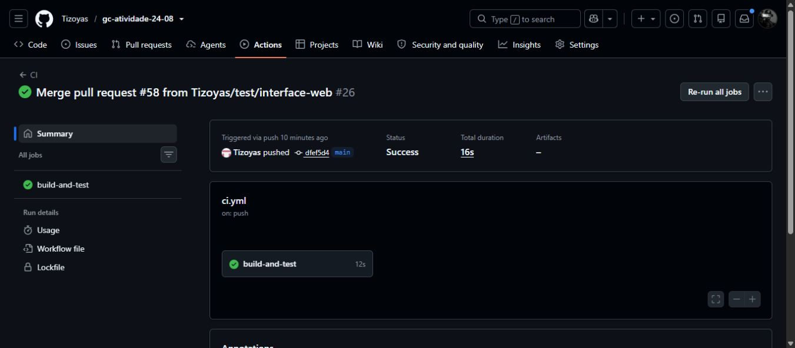

# Evidências do artifact no CI - SISTAC v1.2.0

**Responsável:** Thiago Nunes da Silva Frades - Etapa 11.
**Situação:** PREPARAÇÃO PARCIAL. Geração e publicação do artifact pendentes.
**Consulta:** 24/10/2026 (America/Sao_Paulo).

Este documento registra o estado observado e prepara a coleta exigida pelos PDFs da Atividade 2 (roteiro detalhado, Etapa 11, páginas 9-10; passo a passo, Etapa 11, página 4). Não comprova a geração do pacote v1.2.0 nem a conclusão da release. O CI verde abaixo executou somente instalação, build e testes da aplicação.

## 1. Base consultada e escopo

- Repositório: https://github.com/Tizoyas/gc-atividade-24-08
- Branch de trabalho: `docs/evidencias-artifact`, criada da `main` atualizada.
- Commit da base: [`dfef5d47df685e2c5305e8c6904b2a68c60c105f`](https://github.com/Tizoyas/gc-atividade-24-08/commit/dfef5d47df685e2c5305e8c6904b2a68c60c105f).
- [PR #58](https://github.com/Tizoyas/gc-atividade-24-08/pull/58) integrado na base.
- Nenhum PR aberto encontrado na consulta. As branches remotas foram atualizadas e inspecionadas.
- A branch `chore/versao-1-2-0` contém os commits `54ebdeb` e `96f9349`, alterando os manifestos para 1.2.0, mas essas mudanças ainda não constam na base consultada.
- A `main` ainda declara versão `1.0.0` e não contém script `package`, `scripts/package.js`, verificação de dist, checksum ou smoke test do pacote.
- Não foram encontrados `upload-artifact`, `SHA256SUMS` ou referência a `scripts/package.js` em `.github/` e `app/` das branches remotas consultadas.
- Tags remotas encontradas: `v1.0.0`, `v1.0.1` e `v1.0.2`. A linha-base `v1.1.0`, exigida no início do roteiro, ainda não está publicada. Esta preparação antecipada não substitui esse pré-requisito.

## 2. Execução real disponível: CI da aplicação

| Campo | Evidência observada |
| --- | --- |
| Execução | [CI #26](https://github.com/Tizoyas/gc-atividade-24-08/actions/runs/40139480284) |
| Run ID / tentativa | `40139480284` / `1` |
| Evento / branch | `push` / `main` |
| Commit | `dfef5d47df685e2c5305e8c6904b2a68c60c105f` |
| Início | 24/10/2026 às 19:39:16, UTC-03:00 |
| Resultado | `completed` / `success` |
| Job | [build-and-test](https://github.com/Tizoyas/gc-atividade-24-08/actions/runs/40139480284/job/121007970132) |
| Ambiente nos logs | Node `24.19.0`, npm `11.17.0` |
| Instalação | `npm ci` concluído; 70 pacotes adicionados |
| Build | `npm run build` concluído; log: `Build do SISTAC concluido.` |
| Testes | `npm test`: 15 testes, 15 aprovados, 0 falhas, 0 cancelados e 0 ignorados |
| Empacotamento / checksum / smoke / upload | Etapas ausentes nesta execução |
| Artifacts | Lista vazia na API; interface mostra `Artifacts: –` |

Os logs de instalação, build e testes foram consultados no job acima. O log de instalação também informa uma vulnerabilidade de severidade alta; o job terminou com sucesso. Não foi feita alteração de dependências nesta etapa documental.

O [workflow no commit consultado](https://github.com/Tizoyas/gc-atividade-24-08/blob/dfef5d47df685e2c5305e8c6904b2a68c60c105f/.github/workflows/ci.yml) não possui empacotamento nem `actions/upload-artifact`. O cache do npm não é o artifact distribuível solicitado.

Foram consultadas as 26 execuções retornadas pelo GitHub Actions, incluindo as da branch `chore/versao-1-2-0`. Todas retornaram lista de artifacts vazia. Isso registra a disponibilidade na data da consulta, sem afirmar que arquivos expirados nunca existiram.

### Captura autêntica do estado atual

Captura da página real do run `40139480284`, em 24/10/2026. Comprova o estado atual; **não é evidência de um artifact v1.2.0 gerado**.

## 3. Evidências obrigatórias da release - pendentes

| Requisito | Estado / informação a registrar após execução real |
| --- | --- |
| Execução verde que gera o pacote | PENDENTE: URL, run ID, tentativa, commit, branch/tag e data |
| Instalação, build e testes dessa execução | PENDENTE: links dos logs e resultado exato dos testes da execução que produzir o artifact |
| Validação de dist | PENDENTE: resultado de `node scripts/verificar-dist.js` |
| Geração automática do pacote | PENDENTE: log de `npm run package` |
| Geração do checksum | PENDENTE: log de `node scripts/checksum-release.js` |
| Smoke test do pacote | PENDENTE: log de `node scripts/smoke-package.js` |
| Upload | PENDENTE: etapa `actions/upload-artifact@v4` bem-sucedida |
| Nome do artifact | Esperado pelo roteiro: `sistac-release-package`; ainda não observado |
| Arquivos publicados | Esperados: `sistac-v1.2.0.tar.gz` e `SHA256SUMS.txt`; ainda não disponíveis para inspeção |
| Conteúdo do pacote | PENDENTE: baixar o artifact real, listar os arquivos do tar.gz e conferir os manifestos/versão |
| Integridade | PENDENTE: registrar SHA-256 real do pacote e comparar com `SHA256SUMS.txt` |
| Prints reais | PENDENTE: resumo do run com artifact, etapas de geração/upload e conteúdo baixado |

Nenhum pacote foi gerado localmente para substituir o artifact do Actions. Nenhum valor SHA-256, resultado de smoke test ou link de artifact foi inventado.

## 4. Dependências para concluir

| Responsável conforme o roteiro | Entrega necessária |
| --- | --- |
| Yasmim / grupo (Etapa 1) | Publicar a linha-base anotada `v1.1.0` e confirmar o CI verde |
| Isabela (Etapa 3) | Manual `app/INSTALACAO_RELEASE.md` para inclusão no pacote |
| Fabrício (Etapa 4) | Integrar os manifestos consistentes na versão 1.2.0 |
| Henrique (Etapa 5) | Build distribuível e `app/scripts/package.js`, com comando `npm run package` |
| João Paulo (Etapa 6) | Verificação dos arquivos e da versão em dist |
| João Henrique (Etapa 7) | Smoke test automatizado do pacote extraído |
| Rubens (Etapa 8) | Geração de `SHA256SUMS.txt` para o pacote real |
| Thiago de Oliveira Rodrigues (Etapa 9) | Integrar as etapas no CI e publicar o artifact em execução verde |

Essas implementações pertencem aos respectivos integrantes e não foram alteradas por esta documentação. Thiago Nunes da Silva Frades é responsável por registrar as evidências da Etapa 11.

## 5. Procedimento para finalizar esta documentação

1. Atualizar esta branch com a `main` após as integrações necessárias e confirmar a linha-base do roteiro.
2. Abrir uma execução verde que realmente execute instalação, build, testes, verificação de dist, package, checksum, smoke test e upload; registrar os links dos logs e o commit exato.
3. Baixar `sistac-release-package` dessa execução e extrair o ZIP do GitHub Actions. Conferir a presença de `sistac-v1.2.0.tar.gz` e `SHA256SUMS.txt`.
4. Listar o tar.gz e descrever seu conteúdo observado, incluindo aplicação, manifestos, versão e manual. Recalcular o SHA-256 do tar.gz e comparar com o valor publicado.
5. Salvar capturas autênticas em `docs/evidencias/`, incluir os links relativos e preencher a tabela da seção 3 com resultados reais.
6. Conferir que todas as evidências pertencem à mesma execução/commit. Quando houver tag final, preservar a rastreabilidade exigida pelo roteiro para o pacote usado na release.
7. Somente após completar a coleta, retirar o aviso de preparação parcial, revisar o diff, fazer commit/push e abrir PR para revisão. Não fazer merge nesta etapa.

## 6. Critério de conclusão

- [x] Base, branches, PRs, workflow, execuções e logs atuais consultados.
- [x] Estado atual documentado com link e captura reais.
- [ ] Artifact disponível em execução verde com pacote e checksum.
- [ ] Logs de geração, validação e upload conferidos.
- [ ] Conteúdo e integridade do artifact conferidos.
- [ ] Capturas reais da geração/publicação incluídas.
- [ ] Documento final revisado e PR aberto.

**Conclusão atual:** Etapa 11 preparada parcialmente e aguardando as dependências acima. Release v1.2.0 não declarada concluída.
