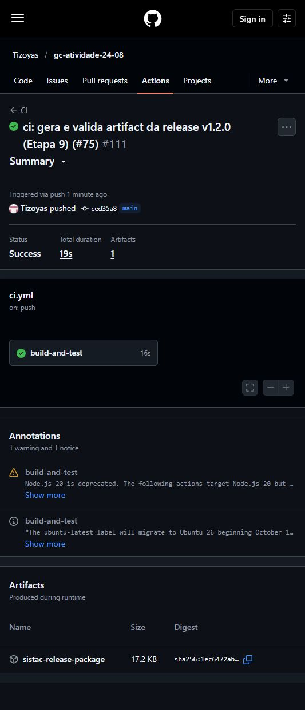
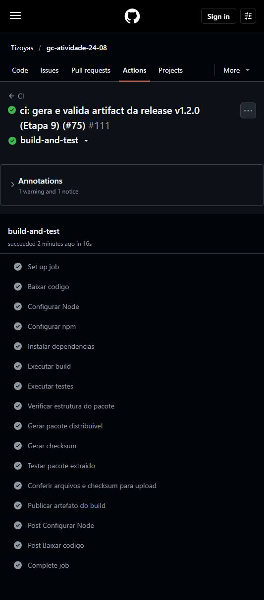

# Evidências do artifact no CI — SISTAC v1.2.0

**Responsável:** Thiago Nunes da Silva Frades — Etapa 11.
**Situação:** evidências verificadas; entrega documental para revisão.
**Coleta:** 24/10/2026 (America/Sao_Paulo).

## Execução real na main

| Campo | Evidência |
| --- | --- |
| Execução | [CI #111](https://github.com/Tizoyas/gc-atividade-24-08/actions/runs/40155320131) |
| Run / tentativa | `40155320131` / `1` |
| Evento / branch | `push` / `main` |
| Commit | [ced35a87a16f34a5ad6008073d0890b8a6be4392](https://github.com/Tizoyas/gc-atividade-24-08/commit/ced35a87a16f34a5ad6008073d0890b8a6be4392) |
| Origem | [PR #75 aprovado e mergeado](https://github.com/Tizoyas/gc-atividade-24-08/pull/75) |
| Início | 24/10/2026 23:40:04 UTC−03:00 (25/10/2026 02:40:04 UTC) |
| Resultado | `completed / success`; duração total de 19 s |
| Job | [build-and-test — 121055381041](https://github.com/Tizoyas/gc-atividade-24-08/actions/runs/40155320131/job/121055381041), sucesso |
| Ambiente dos logs | Ubuntu 24.04.5, Node 24.19.0, npm 11.17.0 |

O workflow verificado é o [ci.yml desse commit](https://github.com/Tizoyas/gc-atividade-24-08/blob/ced35a87a16f34a5ad6008073d0890b8a6be4392/.github/workflows/ci.yml). A comprovação é da execução remota na main, não de um build local.

## Passos conferidos

Todos os passos abaixo retornaram `completed / success` na API. Os resultados foram também conferidos nos [logs autênticos do job](evidencias/ci-111-job.log).

| Passo / link dos logs | Comando ou action | Resultado observado |
| --- | --- | --- |
| [Instalação (5)](https://github.com/Tizoyas/gc-atividade-24-08/actions/runs/40155320131/job/121055381041#step:5:1) | `npm ci` | 70 pacotes adicionados |
| [Build (6)](https://github.com/Tizoyas/gc-atividade-24-08/actions/runs/40155320131/job/121055381041#step:6:1) | `npm run build` | Build do SISTAC concluido. |
| [Testes (7)](https://github.com/Tizoyas/gc-atividade-24-08/actions/runs/40155320131/job/121055381041#step:7:1) | `npm test` | 21 testes aprovados, 0 falhas |
| [Verify-dist (8)](https://github.com/Tizoyas/gc-atividade-24-08/actions/runs/40155320131/job/121055381041#step:8:1) | `node scripts/verificar-dist.js` | Arquivos obrigatórios presentes; versão 1.2.0; Pacote valido. |
| [Package (9)](https://github.com/Tizoyas/gc-atividade-24-08/actions/runs/40155320131/job/121055381041#step:9:1) | `npm run package` | Gerado `app/release/sistac-v1.2.0.tar.gz` |
| [Checksum (10)](https://github.com/Tizoyas/gc-atividade-24-08/actions/runs/40155320131/job/121055381041#step:10:1) | `node scripts/checksum-release.js` | Checksum SHA-256 gerado. |
| [Smoke (11)](https://github.com/Tizoyas/gc-atividade-24-08/actions/runs/40155320131/job/121055381041#step:11:1) | `node scripts/smoke-package.js` | Extração e instalação temporária; /api/health HTTP 200; ok === true; PASSOU; servidor encerrado e pasta removida |
| [Conferência (12)](https://github.com/Tizoyas/gc-atividade-24-08/actions/runs/40155320131/job/121055381041#step:12:1) | `test -s` nos dois arquivos e `sha256sum --check SHA256SUMS.txt` | sistac-v1.2.0.tar.gz: OK |
| [Upload (13)](https://github.com/Tizoyas/gc-atividade-24-08/actions/runs/40155320131/job/121055381041#step:13:1) | `actions/upload-artifact@v4` | Dois arquivos; upload finalizado; ID 12583384478 |

## Artifact real e integridade

- Nome: **sistac-release-package**.
- [Download do artifact 12583384478](https://github.com/Tizoyas/gc-atividade-24-08/actions/runs/40155320131/artifacts/12583384478).
- ZIP: **17.648 bytes**; criado em 25/10/2026 02:40:21 UTC.
- Não expirado na coleta; expiração informada: **23/01/2027 02:40:04 UTC**.
- SHA-256 do ZIP publicado pelo GitHub e recalculado no download:
  `1ec6472ab0839de5797402b73f7fb2ef9754470baa9f6f2ad8b02b74ef4513b9`.

O ZIP foi baixado pelo conector GitHub a partir desse artifact. Seu conteúdo real é:

| Arquivo | Tamanho |
| --- | --- |
| `sistac-v1.2.0.tar.gz` | 17.285 bytes |
| `SHA256SUMS.txt` | 87 bytes |

SHA-256 do **tar.gz**, recalculado e igual ao [SHA256SUMS.txt baixado](evidencias/ci-111-SHA256SUMS.txt):

```text
cba7875387eaaa9ba78f679a002fe441fb54c42e17b93f052e61d8aa46db0c9d  sistac-v1.2.0.tar.gz
```

O digest do ZIP e o checksum do tar.gz referem-se a arquivos diferentes. Ambos foram verificados independentemente.

A [inspeção local dos bytes baixados](evidencias/ci-111-inspecao.txt) lista o tar.gz: `src/server.js`, `src/data.js`, `public/index.html`, CSS e JavaScript, `package.json`, `package-lock.json`, `.env.example` e `INSTALACAO_RELEASE.md`. Os dois manifestos declaram versão **1.2.0**, inclusive a entrada raiz do lockfile. Não há pasta node_modules no pacote. Nenhum pacote local foi gerado para substituir o artifact.

## Capturas autênticas

Capturas sem edição das páginas reais do GitHub durante a coleta. Os logs detalhados foram obtidos pelo conector autenticado; a página capturada estava sem sessão e exibia o resumo das etapas.





A captura antiga do CI #26, preservada no histórico da branch, pertence à preparação anterior e não comprova esta entrega.

## Fontes preservadas e reprodução da conferência

- [Resposta da API do run](evidencias/ci-111-run.json).
- [Resposta da API dos jobs e steps](evidencias/ci-111-jobs.json).
- [Resposta da API dos artifacts](evidencias/ci-111-artifacts.json).
- [Log integral do job remoto](evidencias/ci-111-job.log).
- [Inspeção do download](evidencias/ci-111-inspecao.txt) e [checksum publicado](evidencias/ci-111-SHA256SUMS.txt).

Para repetir, baixar o artifact pelo link acima enquanto estiver disponível, extrair o ZIP e executar `sha256sum --check SHA256SUMS.txt` no diretório extraído. Listar o pacote com `tar -tzf sistac-v1.2.0.tar.gz`. No PowerShell, `Get-FileHash sistac-v1.2.0.tar.gz -Algorithm SHA256` permite comparar com o arquivo de checksum. O download pode exigir login no GitHub.

Os logs registram uma vulnerabilidade alta no npm e avisos das actions sobre Node 20 e migração do ubuntu-latest. São avisos da execução, que terminou com sucesso; esta etapa documental não alterou dependências.

## Conclusão da Etapa 11

- [x] Run real e verde na main, ligado ao merge do PR #75.
- [x] Build, verify-dist, package, checksum, smoke e upload conferidos.
- [x] Artifact real baixado, conteúdo e integridade verificados.
- [x] URLs, logs, metadados e capturas autênticas registrados.
- [x] Documento preparado na branch `docs/evidencias-artifact` para revisão.

Esta entrega comprova o artifact da execução indicada. Não declara concluída a publicação final da release nem substitui as demais etapas da atividade. O PR documental deve ser revisado; não realizar merge nesta etapa.
